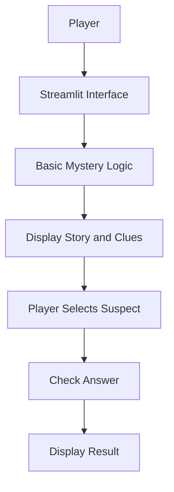
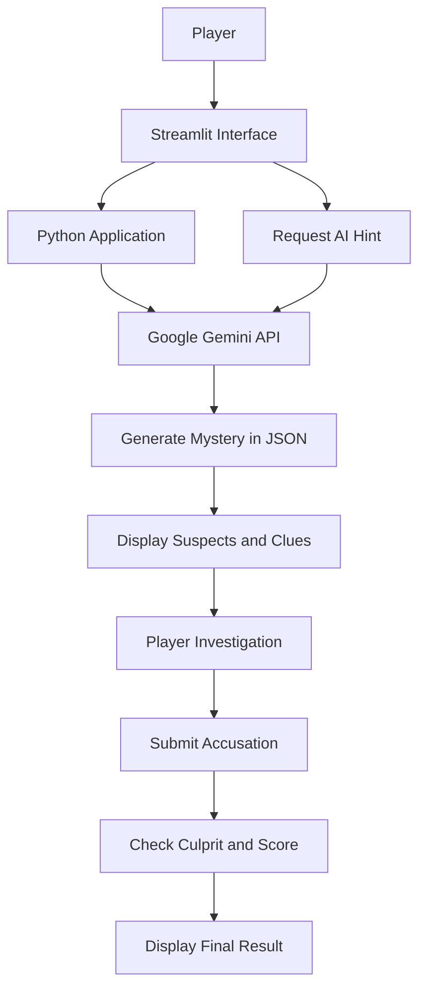

# AI Detective – System Architecture

## Version 1 – Basic Application

## Version 2 – Gemini AI Integration

## Architecture Improvements

- Version 1 provides the basic detective application.
- Version 2 integrates Google Gemini AI.
- Mysteries are generated dynamically.
- Players can request AI-powered hints.
- Difficulty levels and scoring improve interactivity.
